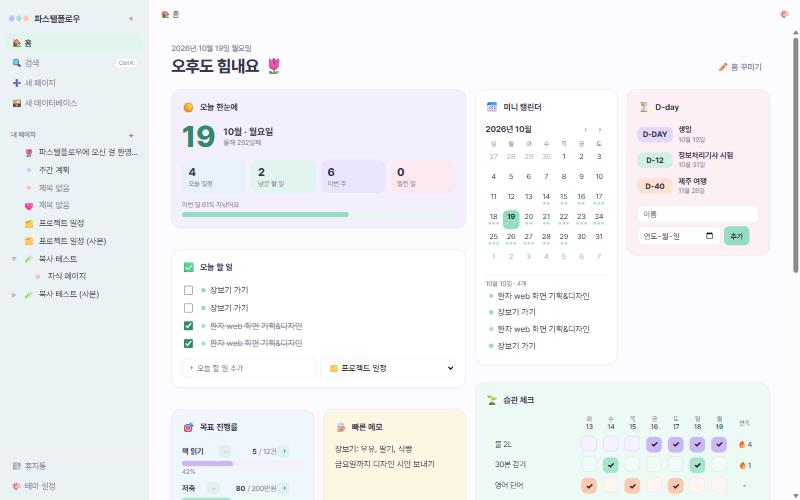
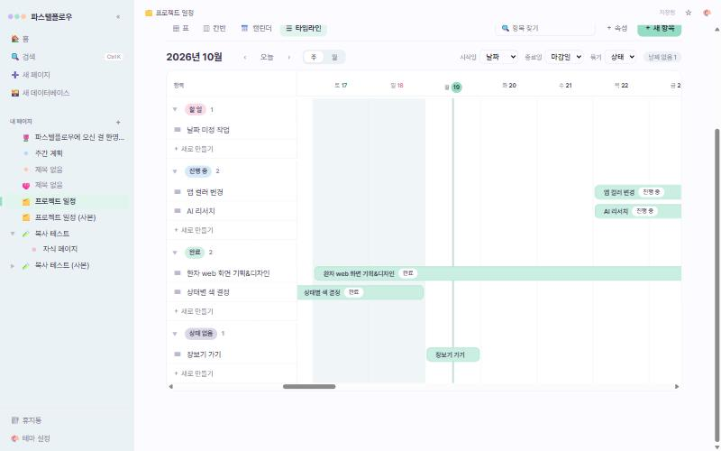
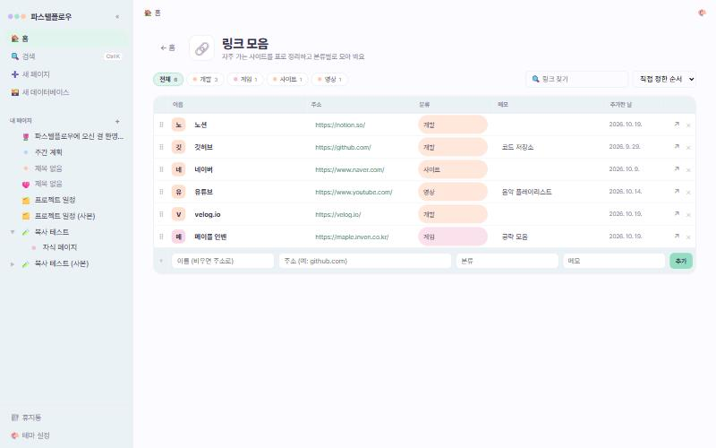

# 🌷 파스텔플로우 (Pastelflow)

블록 에디터, 데이터베이스, 플래너 위젯, 실시간 동시 편집을 갖춘 셀프호스팅 노트 앱입니다. 한국어 화면과 파스텔 테마를 기본으로 하며, 도커 컨테이너 하나(Node.js + SQLite)로 실행됩니다.



| 타임라인 보기 | 가계부 상세 | 링크 모음 |
|---|---|---|
|  |  |  |

## 주요 기능

### 문서
- [BlockNote](https://www.blocknotejs.org/) 기반 블록 에디터: `/` 메뉴로 제목, 목록, 체크리스트, 표, 코드, 인용, 이미지, 파일 블록 추가
- 하위 페이지가 있는 페이지 트리, 끌어서 순서·위치 변경
- 페이지 아이콘과 커버(단색 또는 이미지), 즐겨찾기, 빠른 검색(`Ctrl + K`), 휴지통
- 페이지 복사본 만들기(하위 페이지·데이터베이스 항목 포함)
- 자동 저장

### 데이터베이스
- 속성 5종: 텍스트, 선택(색 태그), 날짜, 체크박스, 숫자
- 보기 4종
  - **표**: 칸에서 바로 편집, 정렬
  - **칸반**: 선택 속성으로 그룹, 카드 끌어서 이동
  - **캘린더**: 월 달력, 날짜 끌어서 변경
  - **타임라인**: 시작일~종료일 막대, 그룹, 주/월 확대, 막대 끌기로 기간 조절
- 항목마다 본문을 쓸 수 있는 상세 패널

### 플래너 홈
- 위젯 10종
  - 오늘 요약, 할 일(데이터베이스 연동), 미니 캘린더, D-day, 습관 체크
  - 목표 진행률, 메모, 가계부, 링크 모음, 최근·즐겨찾기
- 위젯 배치·크기·배경색 편집, 높이에 맞춘 벽돌식 배치
- 위젯마다 상세 페이지 제공
  - 가계부: 월 요약, 일별·분류별 차트, 내역 표, 분류 관리, CSV 내보내기
  - 링크 모음: 분류·검색·정렬이 되는 표

### 함께 쓰기
- 계정 로그인, 관리자가 만든 초대 링크로 가입
- 프로필: 별명, 프로필 사진, 색
- 공용 페이지와 나만 보는 개인 페이지
- 실시간 동시 편집 ([Yjs](https://yjs.dev/) + [Hocuspocus](https://tiptap.dev/docs/hocuspocus)), 다른 사람 커서와 이름표 표시
- 같은 페이지를 보고 있는 사람 표시, 다른 사람의 변경 즉시 반영
- 홈 위젯과 테마는 사람마다 따로

### 화면
- 강조색 6가지, 라이트·다크·시스템 모드, 페이지 폭 설정
- 모바일 화면 대응

## 실행하기 (Docker)

```bash
git clone https://github.com/SirohaKR/pastelflow.git
cd pastelflow
cp .env.example .env      # PUID, PGID 설정
mkdir -p data
docker compose up -d --build
```

기본 설정에서는 `http://서버주소:5190` 으로 접속합니다. 포트는 `docker-compose.yml` 의 `"5190:5210"` 에서 앞쪽 숫자를 바꾸면 됩니다.

처음 접속하면 관리자 계정을 만드는 화면이 나옵니다. 다른 사람은 관리자가 **멤버 관리 → 초대 링크**에서 만든 링크로 가입합니다.

- 컨테이너가 시작할 때 `data` 폴더의 소유자를 `PUID:PGID` 로 맞춘 뒤 해당 사용자 권한으로 서버를 실행합니다.
- 모든 데이터는 `data` 폴더에 저장됩니다.
  - `data/pastelflow.db`: 페이지, 데이터베이스, 위젯, 설정
  - `data/uploads/`: 올린 파일
- 외부에 공개할 때는 역방향 프록시로 HTTPS 를 붙이는 것을 권장합니다.
- 실시간 기능은 웹소켓(`/collab`, `/events`)을 씁니다. 역방향 프록시를 쓴다면 웹소켓 연결을 허용해야 합니다. 시놀로지 역방향 프록시라면 **사용자 지정 머리글 → 만들기 → WebSocket** 을 추가하세요.

### 업데이트

```bash
git pull
docker compose up -d --build
```

### 환경 변수

| 이름 | 기본값 | 설명 |
|---|---|---|
| `PUID` / `PGID` | `1041` / `100` | 서버를 실행할 사용자·그룹 번호 |
| `MAX_UPLOAD_MB` | `20` | 업로드 파일 크기 제한 |
| `PORT` | `5210` | 컨테이너 안 서버 포트 |
| `DATA_DIR` | `/data` | DB와 업로드 파일 위치 |

## 개발

Node.js 24 이상이 필요합니다(내장 `node:sqlite` 사용).

```bash
npm install
npm run dev          # 화면 http://localhost:5173, 서버 5210
npm run build        # 화면을 dist/ 로 빌드
npm start            # 빌드된 화면과 서버 실행
npm run typecheck
```

### 구조

```
server/                Express 서버
  index.js             API, 로그인, 업로드, 정적 파일
  db.js                페이지·데이터베이스 저장소 (SQLite), 공용/개인 권한
  users.js             계정, 세션, 초대 링크
  realtime.js          동시 편집(/collab), 변경 알림·접속자(/events)
  widgets.js           홈 위젯 저장소 (사람마다)
src/                   React + TypeScript 화면
  App.tsx              주소(/, /p/:id, /w/:id), 단축키
  components/
    database/          표·칸반·캘린더·타임라인 보기
    home/              플래너 홈, 위젯, 위젯 상세 페이지
  styles.css           색 토큰과 공통 스타일
docs/                  작업 현황, 예시 이미지
```

## 기술 스택

React 18 · TypeScript · Vite · BlockNote · Mantine · Yjs · Hocuspocus · Express 5 · SQLite(`node:sqlite`) · Pretendard

## 문서

- [변경 기록](CHANGELOG.md)
- [작업 현황과 남은 일](docs/작업-현황.md)
